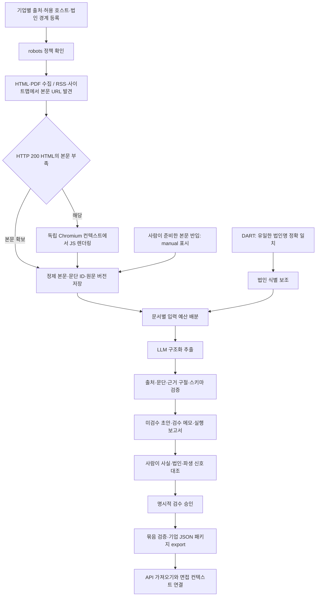

# Re:pit 기업 정보 수집·정제 파이프라인

심사위원 설명 자료 · 2026-10-18

## 1. 해결하려는 문제

기업 맞춤 모의면접에는 회사 이름뿐 아니라 대표 서비스, 공개된 문제 해결 사례, 인재상과 일하는 방식이 필요하다. 이 자료는 채용 사이트·기업 소개·기술 블로그·PDF·공시에 흩어져 있으며 같은 브랜드 안에 여러 법인이 존재한다.

Re:pit은 이 공개 자료를 **출처와 문단 근거가 연결된 기업별 데이터 패키지**로 변환한다. 수집·정제·추출을 재현 가능한 명령으로 실행하고, 사람이 대조한 패키지만 면접에 사용하도록 한다. 현재 기법은 출처 추적형 ETL과 구조화된 기업 컨텍스트 주입이다.

## 2. 구현 흐름



차단·자료 부족·검증 실패는 보고서에 기록한다. 실패한 기업을 임의의 내용으로 채우지 않으며, 다른 기업의 처리는 계속한다. Q의 실제 기업 패키지 DB 반영은 데이터 검수 뒤 수행하는 별도 단계다.

## 3. 적용 기법과 구현 근거

| 기법 | 구현 내용 | 선택 이유 |
|---|---|---|
| 집중 크롤링 | 등록 도메인·시작 URL·관련 경로, RSS/Atom/사이트맵 본문 탐색 | 범위와 출처를 통제하면서 추가 문서를 발견 |
| 정책 기반 접근 | Protego robots 패턴 해석, 호스트별 간격, 요청·크기·시간 상한 | 외부 사이트 정책과 장애를 수집 결과에 반영 |
| 동적 페이지 렌더링 | 정적 본문이 부족할 때 Playwright Chromium 사용 | JS가 만든 텍스트를 읽되 접근 차단은 우회하지 않음 |
| 법인 식별 | OpenDART 고유번호·기업개황의 정규화 법인명 정확 일치 | 브랜드·동명 회사의 식별자 혼동 방지 |
| 구조화 추출 | Claude 도구 호출 + Pydantic 검증 | 문서를 정해진 기업 정보 형식으로 변환 |
| 근거 연결 | sourceKey + passageId + quote | 생성 문장을 사람이 원문과 대조할 수 있게 함 |
| 증분 처리 | 문서 버전·설정·모델·프롬프트·스키마·본문 기록을 반영한 추출 캐시 | 바뀐 입력을 재처리하고 동일 입력의 모델 호출을 줄임 |
| 실행 복구 | 실행 manifest·원자적 상태 저장·--resume | 중단 후 실패 기업을 재시도하고 완료 산출물 보존 |
| 사람 검수 | approve 선언 → reviewed 검사 → export | 형식 검사와 의미 검수를 분리 |

HTML/PDF 처리는 httpx·HTMLParser·PyMuPDF, 동적 페이지는 Playwright, 모델 요청은 Anthropic SDK를 사용한다. Playwright는 별도 company 설치 그룹이다. 문서가 26개 기업의 작은 구조화 컨텍스트로 축약되는 현재 범위에는 벡터 검색을 구현하지 않았다.

## 4. 무엇을 데이터로 만드는가

기업 하나당 schemaVersion 1 JSON 하나를 만든다.

- **기업 기본정보:** 표시명·법인명·분류·검색 별칭. 확인된 경우 DART 코드·사업자번호. 미확인 규모·모회사는 비워 둔다.
- **BUSINESS:** 대표 서비스 2~4개와 고객·제공 가치.
- **PROBLEM:** 해당 서비스·조직이 특정 시점에 공개한 문제 해결 사례. 현재 미해결 문제로 확대하지 않는다.
- **TALENT:** 인재상과 행동 설명. 연습용 긍정·우려 신호는 DERIVED로 구분한다.
- **MISSION_VISION / TECH_STACK:** 문서에서 확인할 수 있는 경우에만 포함한다.
- **출처:** URL·제목·대상 범위·발행일·수집일. 각 사실은 출처를 가리킨다.
- **interviewerBrief:** 수집한 사실 안에서 작성한 600자 이내 면접관 요약.
- **review:** 실제 사람이 대조하기 전에는 항상 null이다.

출력 사실은 합계 20개, 제목 20자·설명 200자 이내다. 인재상 신호는 긍정·우려 각 0~3개다. 근거 문단·원문 구절·처리 이력은 별도 검수 자료로 보관하므로 서버 JSON 계약을 확장하지 않는다.

## 5. 생성 결과를 어떻게 검증하는가

예를 들어 모델이 “제휴 연동 테스트의 불안정성을 줄였다”는 사실을 만들면, 출처 URL뿐 아니라 해당 문단 ID와 짧은 근거 구절을 함께 제출해야 한다. 코드는 그 구절이 **정제한 원문 문단에 실제로 포함되는지** 검사한다. 출처 불일치·없는 문단·없는 구절·형식 위반은 초안 저장을 거부한다.

이 검사는 요약 의미 전체가 정확하다는 증명이 아니다. 사람이 문맥·서비스 운영 법인·역사적 시점·파생 신호의 과도한 해석을 확인해야 한다. 모델이 제시한 신뢰도 수치를 승인 근거로 사용하지 않는다.

별도 보호 장치:

- 웹 문서를 지시가 아닌 자료로 취급하고 회사 소속·내부 사실을 추정하지 않도록 프롬프트를 제한한다.
- robots 차단과 정책 조회 실패, HTTP 403, JS 본문 부족, 네트워크 실패를 구분한다.
- 브라우저 HTTP 요청은 등록 호스트의 GET 경로로 중계하고 사용자 세션·로그인·쿠키를 가져오지 않는다. WebSocket과 불필요한 자원은 차단한다. 이는 애플리케이션 수준 요청 통제이며 OS 네트워크 방화벽을 제공한다는 뜻은 아니다.
- 개인정보처리방침·약관은 법인 식별 참고로만 사용하며 서비스·인재상 사실의 근거로 제출하면 거부한다.
- API 키는 환경변수로만 받고 실행 보고서·출처 URL·캐시에 기록하지 않는다. doctor는 존재 여부만 출력한다.
- 모델 요청 상한은 기본 1회이며 전체 실행의 상한을 명시할 수 있다. 실패 요청도 시작 수에 포함하고 자동 재시도하지 않는다.
- SAMPLE 데모는 실제 검수 승인·export에서 거부한다.

## 6. 면접과 피드백에 연결되는 방식

기업 데이터 패키지는 API가 가져오는 입력 계약이다. 면접 생성 시 기업 정보를 스냅샷으로 고정하는 구조이므로 이후 자료를 갱신해도 이전 면접 기준을 보존한다.

- 원질문의 확인 목표를 유지하면서 서비스·공개 사례·인재상을 질문 맥락에 반영한다.
- 실시간 꼬리질문에는 기업 요약을 전달한다.
- 기업 관점 피드백은 기존 답변 채점과 별도로 생성한다. 점수·등급·채용 가능성 판정을 추가하지 않는다.

현재 실제 기업 초안은 검수 전 상태이므로 실제 기업 데이터의 운영 반영 완료를 주장하지 않는다.

## 7. 심사 현장 재현 순서

저장소 루트에서 다음을 실행한다. Python 3.12 이상과 uv가 필요하며, 첫 설치는 패키지 다운로드 네트워크가 필요하다.

```sh
uv sync --frozen --group company
uv run --group company playwright install chromium
uv run --group company python -m company_seed pipeline doctor --all
uv run --group company python -m company_seed pipeline demo --out company_seed/.cache/runs/judging-demo
uv run --group company python -m company_seed pipeline summary --file company_seed/.cache/runs/judging-demo/report.json
uv run --group company python -m company_seed pipeline demo --out company_seed/.cache/runs/judging-demo --resume
```

demo는 **가상 SAMPLE 기업 + HTTP 대역 + 결정적 모델 대역**을 사용한다. 설치가 끝난 환경에서는 외부 사이트·API 키·유료 모델 호출 없이 재현한다. 결과는 문서 1개·사실 3개·SAMPLE_DEMO 모드이며 실제 모델 요청은 0이다. 이 값은 실모델 정확도나 실제 기업 수집 성능이 아니다.

보여 줄 파일은 `run.json`(실행 조건), `report.json`(단계별 결과), `drafts/sample-pipeline.json`(구조화 결과), `review/sample-pipeline.md`(근거 연결)다. 재개 시 기존 결과를 유지하는 출력과, SAMPLE의 approve/export 거부도 확인할 수 있다.

실제 수집·추출은 별도로 실행한다. extract/run에는 ANTHROPIC_API_KEY와 사용 가능한 모델 ID가 필요하다.

```sh
uv run --group company python -m company_seed pipeline collect --company toss --out company_seed/.cache/runs/toss-live
uv run --group company python -m company_seed pipeline extract --company toss --model claude-sonnet-4-6 --max-model-calls 1 --out company_seed/.cache/runs/toss-live-extract
```

현재 환경에는 Anthropic·DART 키가 설정되지 않아 실 API 추출과 식별 보조 호출을 실행하지 않았다. 이 부분은 HTTP/SDK 대역으로 계약을 검증했고, 실제 Chromium 실행은 로컬 테스트로 확인했다. 세부 운용·수동 반입·검수 승인 명령은 [collection-guide.md](collection-guide.md)에 있다.

## 8. 검증 결과를 읽는 기준

최종 코드 검사·실수집 기록은 [validation-ready-2026-10-18.md](validation-ready-2026-10-18.md)에 별도로 기록한다. 최초 HTTP 점검 결과는 7 성공·14 부분·5 본문 없음, 문서 버전 81개였으며 개선 후 점검을 구분한다.

다음 지표를 혼동하지 않는다.

| 지표 | 의미 | 증명하지 않는 것 |
|---|---|---|
| 자동 테스트 통과 | 지정한 입력에서 코드·정책·계약 동작 확인 | 실데이터 전체 정확도 |
| 수집 성공 | 제한된 방문 범위에서 본문 확보 | 기업별 필수 정보 충족·검수 완료 |
| 구절 일치 검사 | 지정 문단에 제출 구절 존재 | 요약 의미의 정확성·법인 귀속 |
| 생성 초안 수 | 형식·근거 연결 검사를 통과한 패키지 수 | 사람 검수 완료 수 |
| SAMPLE 데모 결과 | 외부 의존성 없이 처리 흐름 재현 | 실제 LLM 성능·실기업 데이터 성능 |

실제 의미 정확도는 사람이 만든 정답 기준으로 사실별 근거 충실도·법인 혼동·누락을 평가해야 한다. 현재 이 실측은 미완료이며 정확도 수치를 제시하지 않는다. 사람 검수 완료 패키지는 0개다.

## 9. 주요 질의에 대한 답변

**왜 사람 검수가 필요한가?** 구절이 존재해도 회사 전체 이야기로 과도하게 일반화하거나 다른 계열사의 사례로 오해할 수 있다. 코드 검증은 구조와 연결을 확인하고 사람이 의미와 범위를 확인한다.

**회사 하나를 추가하려면?** 기업 코드·허용 호스트·법인 경계·출처를 registry에 등록하고 같은 수집·추출·검수 명령을 실행한다. 출처 등록과 검수는 필요한 운영 작업이다.

**자료가 바뀌면?** 실행 시 문서 버전을 비교한다. 입력·모델·프롬프트·스키마가 같은 추출은 재사용하고 변경 시 재추출한다. 사람이 검수한 결과만 새 패키지로 전달한다. 정기 실행 서비스는 만들지 않았다.

**자료가 막히거나 이름이 모호하면?** 실패·미확인 상태를 유지한다. 허용된 대체 출처를 등록하거나 사람이 준비한 원문을 manual로 반입할 수 있다. 법인 코드는 유사 이름만으로 연결하지 않는다.

**지금 실행 가능한가?** 키 없는 SAMPLE 데모와 실제 수집 CLI는 실행 가능하다. 실제 모델 추출은 사용자 키·모델 접근 권한을 설정해 실행한다. 외부 사이트 접근과 데이터 검수 완료는 실행 도구의 구현 완료와 구분한다.

## 10. 기술 참고

- [Playwright 네트워크 제어](https://playwright.dev/python/docs/network)
- [Protego robots 해석](https://github.com/scrapy/protego)
- [OpenDART 고유번호](https://opendart.fss.or.kr/guide/detail.do?apiGrpCd=DS001&apiId=2019018), [기업개황](https://opendart.fss.or.kr/guide/detail.do?apiGrpCd=DS001&apiId=2019002)
- 구현·실행 안내·검증 기록은 [Draft PR #37](https://github.com/Alpha-origin/repit-analysis-server-v2/pull/37)에서 확인할 수 있다.
